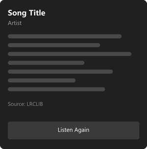

# Music Lyrics Widget

A Windows 11 widget for the Widgets Board that listens through the microphone, recognises the song that is playing
(via [ACRCloud](https://www.acrcloud.com/)) and shows its lyrics (via [LRCLIB](https://lrclib.net/)). When synced
lyrics are available, the line being sung is highlighted and the card follows the song.



## Features

- **Recognises music playing nearby** — from a speaker, phone or radio — using 10-second samples every 30 seconds.
- **Synced lyrics**: the current line in bold, with the previous line(s) above and the next lines below. Re-syncs on
  every recognition, so pauses and seeks on the player are corrected automatically.
- **Medium and large card sizes**, each with its own line budget so nothing is cut off.
- **Privacy**: the microphone is only used after you press *Listen Now*, and only while the Widgets panel is open.
  Closing the panel pauses listening (the song and lyrics stay on the card); opening it resumes.
- **Laptop microphones that suppress music** (e.g. Intel Smart Sound arrays with built-in noise suppression) are
  recorded in WASAPI RAW mode, so the music is not filtered away before recognition.

## Requirements

- Windows 11 (build 22621 or later) with **Developer Mode** enabled (the package is registered unsigned).
- Visual Studio 2022+ with the *Windows application development* workload, or the .NET 8 SDK.
- An **ACRCloud** account with an audio recognition project that uses ACRCloud's music database. You need the
  project's host, access key and access secret. LRCLIB needs no account.

## Build and run

```powershell
dotnet build MusicLyricsWidget.sln -c Debug -p:Platform=x64
dotnet test MusicLyricsWidget.Tests/MusicLyricsWidget.Tests.csproj -c Debug -p:Platform=x64
```

Deploy the MSIX package from Visual Studio (*Deploy*, x64). Then:

1. Start **Music Lyrics Widget** from the Start menu and enter your ACRCloud host, access key and access secret.
   *Test Recognition* checks the setup.
2. Open the Widgets Board (**Win + W**) → **+** → add **Music Lyrics**.
3. Play music and press **Listen Now**.

The settings are stored in `%LOCALAPPDATA%\MusicLyricsWidget\settings.json` (outside the repository).

## How it works

| Part | Role |
|---|---|
| `Program.cs` | One executable, two modes: COM server for the Widget Host (`-RegisterProcessAsComServer`) or the settings window |
| `Widget/LyricsWidgetProvider.cs` | `IWidgetProvider`: Listen Now, pause on panel close, resume on open |
| `Services/RawMicrophoneCapture.cs` | Microphone capture in WASAPI RAW mode |
| `Services/SongIdentificationService.cs` | ACRCloud identification, incl. the song position at the end of the sample |
| `Services/LyricsService.cs` | LRCLIB lookup (exact match by duration, then search), honours `Retry-After` |
| `Services/MusicRecognitionOrchestrator.cs` | Recognition loop and states; owns the lyrics clock |
| `Services/LyricsClock.cs` | Follows the playback position and fires at each lyrics line change |
| `Widget/WidgetStateManager.cs` + `WidgetTemplates/` | Adaptive Card templates and data per state and widget size |

Design notes, decisions and the backlog are in [`docs/`](docs/) and [`CLAUDE.md`](CLAUDE.md) (in Danish).

## Notes

- The repository contains no lyrics; they are fetched from LRCLIB at runtime and shown for personal use.
- ACRCloud's free tier has a request quota; the widget sends one request per 30 seconds while listening.

## License

[MIT](LICENSE)
